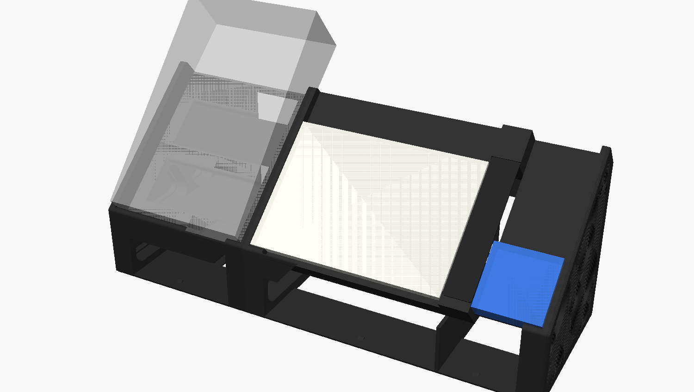
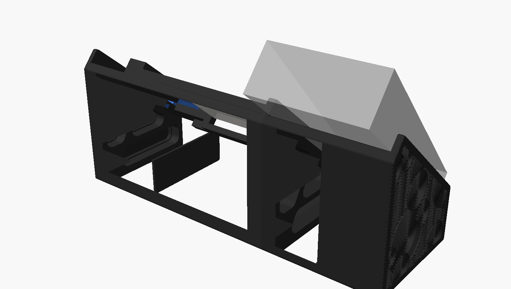
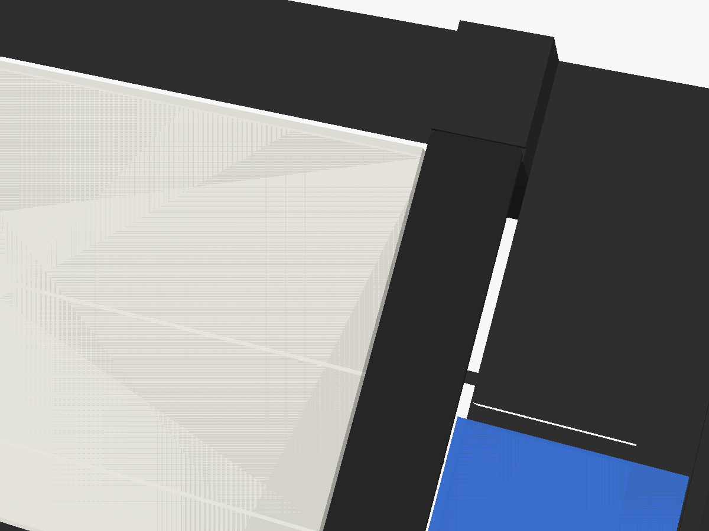
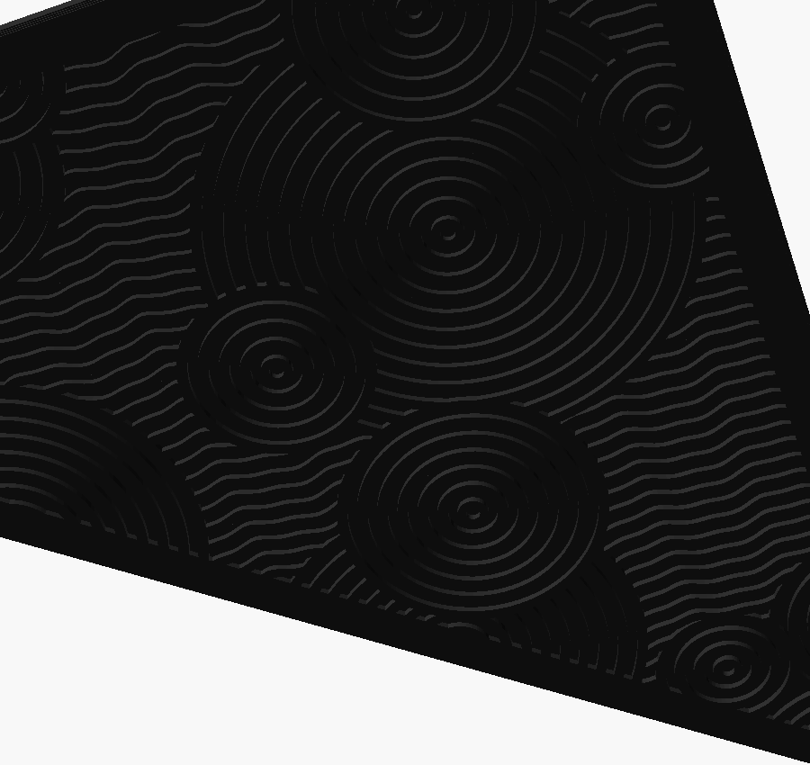

# AG03（初代）用 40° スタンド（ネジ・接着剤なし）

YAMAHA AG03（初代。AG03MK2 にも切替可）を **底面40°** に傾けてデスクに置くための土台です。

- **ネジ・接着剤ゼロ**：左右2パーツを圧入ダボ（直径6mm × 11か所）で差し込むだけ。床板の継ぎ目は相欠き（重ね継ぎ）で上下にずれない
- **引き出し付き**：AG03 の下の空間に、手前に引き出せるトレイ（内寸 約112 × 98 × 35 mm）。左右のフレームの内面がガイドになり、台の床板の上を滑るのでレールも不要
  - 閉めると前板が左右の前脚の前面と面一。取っ手は前板の上端を全幅で手前へ張り出した「ひさし」（出っ張り8 mm、上面は引き出しの縁と面一、下面45°でサポート不要）で、指を下から掛けて引く
  - 引き出しの上は台の天井板（厚さ3mm）でふさいであるので、閉めると上からは中が見えない
  - 抜け止めはなし（引き出しは奥の横桁に当たって止まり、手前にはそのまま抜ける）
  - 底の外周を0.4mm面取りしてあり、1層目の広がり（象の足）でフレームとこすれにくい
- **引き出しの上は補強の箱**：天井板と傾斜面のあいだ（AG03 の下に隠れるデッドスペース）を構造に使う。天井板を 10mm に厚くし（引き出しの高さは変わらない）、傾斜面の下に全幅の板（4mm、AG03 に触れないよう 1mm 下げる）、側面フレームの斜材と同じ線に斜めの仕切り（5mm）を入れて、閉じた三角の箱にした。天井板より上の背板は側面フレームの後ろの柱と同じ 6.5mm。引き出しの奥（引き出しの止め〜背面、床〜天井）は増設台と同じ太い梁にした（中身はインフィル）。ねじれ・たわみに強く、左右の継ぎ目も厚い天井板と奥の梁のダボ 3 本が増えて開きにくい。補強は左右フレームの内側だけなので、側面の穴・パネル・連結キーはそのまま。厚い天井板の端は 45° より急な斜面で立ち上げてあり、サポート不要
- **底面・背面は閉じた面**：机に接する底は全面が床板（3mm）、AG03 の後ろに隠れる背面も背板（3mm）でふさいである。横の肉抜き穴はそのまま
- **サポート不要**：どちらも外側の側板を下にして寝かせるだけで印刷できる（全部が Z 方向への押し出し形状）
- **端子をふさがない**：背面端子は上向きになるので完全フリー（初代 AG03 は前面のストッパーが当たる範囲に端子がない）
- **前倒れ防止**：手前ストッパーの先端から机まで垂直に落とした前脚を左右の角に設置
- **前板**：左右の手前ストッパーを全幅の前板（高さ17mm）でつなぎ、前脚・引き出しの前面と面一の平らな正面にした
- **横ズレ防止**：左右の側板（ガイド壁 高さ17mm）で本体をはさむ。AG03 は全体が曲面仕上げなので、一番幅のある高さ（底から17mm）で前板・側板の両方が受ける
- **シンプルな外形**：平らな底・垂直な前面と背面・傾斜面だけで構成。外に出る角は R3 で丸め、肉抜き穴は角を R9 で丸めた三角形

    

## 3Dビューア

`viewer/index.html` をブラウザで開くと、全パーツを組み立てた状態（分解表示・色分け・部品ごとの表示切替・クリックで寸法表示）と、印刷用 STL を A1 mini のベッド上で、ぐりぐり回して見られる。

- GitHub Pages などの Web サーバー経由で開く（ファイルを直接開くとブラウザの制限で STL を読めない。その場合は STL を画面にドロップすれば表示できる）
- STL を変えたら `bash tools/export_viewer.sh` でビューア用の STL（`viewer/stl/`）を書き出し直す

## ファイル

| ファイル | 内容 |
|---|---|
| `ag03_stand.scad` | パラメトリック設計データ（OpenSCAD） |
| `ag03_stand_half_a.stl` | パーツA（左・ダボ＝オス）。この向きのまま印刷。**印刷済みの初版を使い続けるので刷り直さない**（A・B を両方刷り直すとき用） |
| `ag03_stand_half_b.stl` | パーツB（右・ダボ穴＝メス）。この向きのまま印刷。版2。印刷済みの初版パーツA とも、版2 のパーツA とも組める |
| `ag03_stand_drawer.stl` | 引き出し。開口を上にしてこの向きのまま印刷 |
| `ag03_stand_fit_test.stl` | 圧入テスト片（直径6mmのダボ＋穴のクリアランス 0.10 / 0.15 / 0.20mm、溝の本数 1/2/3 本が目印） |

## 寸法

| 項目 | 値 |
|---|---|
| 1パーツの印刷サイズ | 約 136 × 163 × 77 mm（Bambu A1 mini 等 180mm 角ベッドに収まる） |
| 引き出しの印刷サイズ | 外寸 117 × 101 × 37 mm＋取っ手 8 mm（内寸 約112 × 98 × 35 mm、前板・底 2.4mm、壁 1.6mm） |
| 組立後の外形 | 幅 約138mm × 奥行 約136mm × 高さ 約163mm |
| 本体手前下端の高さ | 55 mm（この下を引き出しが通る。前面プラグの逃げも兼ねる） |
| 手前ストッパー・側板の高さ | どちらも 17.0 mm（本体底面から）。前板は全幅で AG03 の前面を受ける |
| 本体を乗せた全高 | 約 226 mm |
| 重心 | 本体（坂形）の重心は机の上で前脚の前面から約87mm・台の後端から約49mm（接地の奥行 約136mm の内側）→ 前にも後ろにも倒れにくい |

初代 AG03 で設計（同梱STLはこの寸法）。幅 128.8 mm・手前の高さ 28.0 mm・奥の高さ 54.3 mm は実機のノギス実測値、奥行 202 mm は公称値。初代は天板が底面に対して約7.4°手前に傾いた坂形なので、底面40°に置くと操作面は約47.4°になります。側板の内側は 130.0 mm（片側すき間 0.6 mm）。AG03MK2（126 × 63 × 201 mm）に使う場合は `.scad` の `model = "AG03MK2";` に切り替えて書き出してください。

## 増設台（Kindle Paperwhite 横置き＋M5Stack Basic）

AG03 台の右に連結して、左から **AG03｜Kindle Paperwhite（第10世代・横置き）｜ケーブルの通り道｜M5Stack Basic** を同じ 40° で並べる。

  

- **共通規格**：側面の形・前の線（機器の手前下端＝机から55mm）・前板の高さ・天井板・床板・側面の穴はすべて AG03 台と同じ。違うのは幅と機器の座り方だけ
- **機器の前面は前板の上端にそろえる**：Kindle（厚み8.2mm）は座面を 8.8mm 持ち上げ、M5Stack（厚み17.6mm）はそのまま置く
- **上面は全部面一**：AG03 に合わせた傾斜の長さが余る Kindle・M5Stack の上側は、前板の上端の高さまで埋めて、機器・前板・ケーブルカバーと同じ平らな面にした。機器の上端の中央には取り出し用の指掛け（幅36mm、両端45°でサポート不要）
- **ケーブルは挿したまま**：Kindle の端子（右側面）と M5Stack の USB-C（左側面の中央）の間に幅24mmの通り道。L字プラグ前提（Kindle は microUSB→USB-C の L字変換。本体に沿って奥へ伸びる向きを選ぶ）。ケーブルは通り道の下の天井の穴から下段（M5Stack 側）へ落とし、**M5Stack の下の床の穴から机の穴へ**通す。床の穴は **Kindle の下にもある**（どちらも前後 45〜90mm、`floor_hole_x0/x1` で調整。Kindle 側は幅方向 62〜114mm＝Kindle の中央、`kin_hole_z0/z1`）。四隅を 45° に落とした八角形で、印刷で穴の上辺になる橋渡しは 17mm 程度に抑えてある。机の穴から上がってきた他のケーブルも、床の穴から下段を通って正面の口から引き出せる
- **ケーブルは見えない**：通り道の上にケーブルカバー（`ag03_stand_ext_cover.stl`、上面を下にして印刷）をかぶせる。手前と奥の受け台の溝に差し込むだけで、外せばケーブルの抜き差しができる。カバーの上面は前板の上端（＝機器の前面）と面一。受け台を一段下げてはめ込み、カバー裏の左右（L字アダプタが来る側）を 0.8mm くぼませて逃がし（アダプタの厚みが約 6.6mm までなら当たらない）、中央にはたわみ止めのリブ。差し込み部のすき間はダボと同じ 0.10mm
- **M5Stack の上は隠し収納**：M5Stack の上側の埋め（デッドスペース）をくり抜いた小物入れ（口 約 68 × 48mm、深さ 14.6mm、約 40cm³。SD カード・USB メモリ・ピック・Grove ユニット・ATOM など）。上面と面一のフタ（`ag03_stand_ext_lid.stl`、厚さ 2.4mm）を段に落とし込むだけ。フタの手前の縁は M5Stack の指掛けの上に少しかかるので、同じ指掛けに指を入れて持ち上げる。収納の底は M5Stack の座面の板で、下の補強の箱はそのまま。左端（通り道側）は印刷で上になるので、段とフタの縁を斜めにし、収納の底へ下りる斜面にしてサポート不要
- **奥の下は太い梁**：背面・床の後ろは閉じ、奥の下（床〜天井の高さ）を全幅の梁にして、分割面ごとにダボ 2 本で接合（強度アップ）。Kindle 側・M5Stack 側の下段の上も AG03 台と同じく天井板 10mm＋斜めの仕切りで補強（通り道の下はケーブルが通るので 3mm のまま）。P1｜P2 の継ぎ目には天井板のダボ 2 本を追加
- **引き出しは後から付けられる**：Kindle 側・M5Stack 側とも、天井板・床板・仕切り・奥の壁（止め）を用意済み（今は引き出しなし）。床板は 4mm（AG03 台は 3mm）なので、増設台用の引き出しを作るなら底の高さを `ext_t_floor` に合わせる
- **連結**：AG03 台の右面（パーツB側）と増設台の左の枠を、連結キー（穴の形のリング3個）で両側から差し込んでつなぐ。波紋パネルは `panel_a` を AG03 台の左面、`panel_b` を増設台の右面に付ける

| ファイル | 内容 | 印刷の向き |
|---|---|---|
| `ag03_stand_ext_p1.stl` | 増設台 1/4（左の枠＋Kindle の左側） | 左の枠を下に |
| `ag03_stand_ext_p2.stl` | 増設台 2/4（Kindle の右側） | このまま |
| `ag03_stand_ext_p3.stl` | 増設台 3/4（ケーブルの通り道） | このまま |
| `ag03_stand_ext_p4.stl` | 増設台 4/4（M5Stack＋右の枠） | 右の外面を下に（このまま） |
| `ag03_stand_ext_keys.stl` | 連結キー 3 個 | このまま |
| `ag03_stand_ext_cover.stl` | ケーブルカバー | 上面を下に（このまま） |
| `ag03_stand_ext_lid.stl` | 隠し収納のフタ（M5Stack の上） | 上面を下に（このまま） |

- 全体の幅 約 396mm（AG03 台 138＋増設台 255.5＋両端のパネル）。1 パーツの印刷サイズは最大 約 136 × 163 × 92mm
- ダボは AG03 台と同じ（直径6mm・すき間0.10mm）。P1→P2→P3 は前のパーツのダボを次のパーツの下の穴へ、P4 はダボを P3 の上の穴へ差し込む
- 材料の目安 4 パーツ合計 約 400g（壁4周・インフィル15%）

## モジュール構成と拡張

全体は「モジュール」を左から並べて連結キーでつなぐ作り。どのモジュールも両端は同じ規格の枠（側面の形・前板の高さ・肉抜き穴）なので、右へいくらでも足せる。右端には波紋パネル（`panel_b`）を付ける。

```
[パネル] AG03 台（左A｜右B） =キー= 増設台（P1｜P2｜P3｜P4） =キー= 次のモジュール … [パネル]
```

### 新しいモジュールを作る

`ag03_stand.scad` の `mod_bays` に、左から並べるもの（ベイ）を書くだけ。

| ベイ | 書き方 | 中身 |
|---|---|---|
| 機器 | `["dev", 幅, 傾斜方向の長さ, 厚み]` | 前面を前板の上端にそろえて置く（薄い機器は座面を持ち上げる）。上側の空きは面一に埋め、指掛けと床の穴（`mod_floor_holes`）を付ける |
| ケーブルの通り道 | `["chan"]` | 幅 24mm、増設台と同じカバーが付く。両どなりは機器にする（端には置けない） |
| 小物置き | `["blank", 幅]` | 前板の高さで平らにふさぐ |

例（既定値）: `mod_bays = [["dev", 54.1, 54.1, 17.6], ["blank", 50]]` → M5Stack をもう 1 台＋小物置き。幅 113mm、2 部品。

- 印刷の分割は自動（ベイの境目ごと、長いベイは `mod_max_piece`＝95mm 以下に等分）。部品数は OpenSCAD のコンソールに出る
- 書き出し: `openscad -D 'part="mod_p"' -D 'mod_piece=1' -o mod_p1.stl ag03_stand.scad`（2, 3 … と部品の数だけ）。左端の部品は左の枠を、右端の部品は右の枠を下にした向きで出る。サポート不要
- 部品どうしは増設台と同じダボ、となりのモジュールとは連結キー（`ag03_stand_ext_keys.stl` をもう 1 セット）でつなぐ
- 組み立て表示: `part="mod_view"`（増設台の右どなりに付けた状態）

### 規格（変えると印刷済みの部品と合わなくなる値）

`tilt` `H0` `S` `t_top` `lip_t` `lip_h` `guide_h` `g` `frame_w` `m` `t_base` `R_out` `R_hole`（側面の形と穴）、`peg_d` `peg_len` `fit_tol` `plug_*`（ダボ・連結キー）、`dev_w` `clr`（AG03 台の幅）、`kin_w` `chan_w` `dev_clr`（増設台の継ぎ目の位置）、`pegs_v1` `pegs_c1〜c3`（継ぎ目のダボの位置）

## 刷り直し（部品ごとの入れ替え）

印刷済みの部品とその版は [`printed.md`](printed.md) に記録してある。刷り直す部品は、印刷済みの部品とそのまま組めるように継ぎ目（ダボの位置・断面・連結の穴）を固定してある。

- **AG03 台は右（パーツB）だけ刷り直す**：B は初版パーツA のダボ 8 本（`pegs_v1`）と床の舌をそのまま受ける。補強で増えたダボ 3 本（`pegs_v2`）は B に穴だけある（初版の A と組むときは空き穴）。補強の箱・奥の梁は B の側だけでも効く
- **増設台は M5Stack 部（P4）だけ刷り直せる**：P3 との継ぎ目（`pegs_c3` と断面）は固定。M5Stack を別の機種に替えても（`m5_w` `m5_h` `m5_t` を変える）、P3 との継ぎ目と右端の枠は同じ。前板より薄い機種なら座面を自動で持ち上げる
- 印刷前に `python3 tools/compat_check.py` で、印刷済みの部品（git の履歴から取り出す）と重ならないことを確かめる（要 `pip install trimesh manifold3d`）

## 側面の化粧パネル（任意）

台の外側の面（印刷時のプレート面）をおおうパネル。裏のリムを台の側面の肉抜き穴（下段の長穴・上段の三角2つ）に差し込んで摩擦で留める。台は刷り直し不要、ネジ・接着剤なし。

 

| ファイル | 内容 |
|---|---|
| `ag03_stand_panel_a.stl` | 左パネル（パーツA側）。表面を下にしてこの向きのまま印刷 |
| `ag03_stand_panel_b.stl` | 右パネル（パーツB側）。同上 |
| `ripple_pattern.scad` | 「波紋」模様のデータ（`tools/gen_ripple.py` で自動生成。`--seed` を変えると円の配置が変わる） |

- 厚み 2.4mm。**黒 1 色で印刷する前提**で、表面に模様を 1.0mm 彫り、溝の陰影とツヤの差で模様を見せる。表面はプレート面、溝の底はブリッジ面なので質感が変わり、1 色でも模様が浮かぶ（スムーズPEIで刷ると表がツヤあり・溝がマットになり特に映える）
- 既定の模様は「波紋」（参考画像を分析した描画ルール：①一番下に、同じ形の波線を一定間隔で全面に引く → ②その上に大きな同心円（輪10本前後）を重ねて下の線を隠す → ③さらにその上に中（輪5〜6本）・小（輪3〜4本）の同心円を、下の円の縁にかぶせて重ねる。線の太さ・間隔は波線も輪も共通、円の中心は小さな点、上の円の外側にはふつうの線間と同じすき間を空けて下の線を断つ）。比較は `ripple_vs_reference.png`。`panel_style` で `eq` / `wave` / `grille` / `lines` / `relic` / `rune` / `stone` / `plain` にも切り替えられる（比較：`side_panel_concepts.png`、`side_panel_concepts_fantasy.png`）
- （任意）2 色にしたくなったら、0.4mm（2層目のあと）でフィラメントを替えれば表と溝の色を分けられる
- リムと穴のすき間は 0.10mm（`plug_tol`）。緩ければ 0.05、固ければ 0.15 に
- 付けると左右に 2.4mm ずつ厚くなる（幅 約143mm）。AG03 の収まる内寸は変わらない

## 印刷設定（目安）

- 素材：PLA または PETG
- レイヤー 0.2mm / 壁 3周 / インフィル 15〜20%（ジャイロイド）/ **サポートなし**
- 1パーツ あたり 約180〜210g（2個で 約400g）、引き出し 約60g
- 床板・背板・天井板は印刷の向きだと高さ約51mmの薄い壁になるので、**ブリム（5mm程度）を付ける**と揺れ・反りを防げる。壁の周回数は 4 周以上にすると板が中まで詰まる
- **増設台の P1・P2 は高さ約86mm**、P4 は約65mm と背が高い。どれも**ブリム 5〜8mm**、壁 4〜5 周を推奨。床板は前側が片持ち（正面の口が開いている）なので、増設台だけ 4mm に厚くしてある
- 増設台の分割面は最上層の面積が小さい（ダボだけ）ので、最小レイヤー時間を有効に
- ダボと床板の舌（パーツAの上に飛び出す細い部分）は最後に印刷される小さな部分なので、スライサーの「最小レイヤー時間」を有効にして冷却を確保するときれいに出る
- 引き出しは象の足補正（Elephant foot compensation）0.1〜0.2mm も併用するとよりスムーズ
- 引き出しは壁が薄い（1.6mm）ので、壁の周回数は 4 周（0.4mmノズル）にすると中まで詰まって丈夫

## 組み立て

1. まず `fit_test` を印刷して、手で押し込んで「固いけど入る」穴を確認（溝の本数＝ 1本:0.10 / 2本:0.15 / 3本:0.20mm）
2. 0.10mm（1本溝）以外がちょうど良ければ `fit_tol` を書き換えて STL を再出力（同梱STLは直径5mmダボのテストで ① 0.10mm がぴったりだった結果を反映。直径6mmでも同じ値の見込みだが、テスト片で確認推奨）
3. パーツA のダボと床板の舌をパーツB の穴・切り欠きに合わせ、机の上で手のひらで押し込む
4. AG03 を乗せ、手前の角を左右のストッパーに当てる
5. 引き出しを手前から差し込む（奥は後ろ下の横桁に当たって止まる）

## 調整できる主なパラメータ（`ag03_stand.scad` 冒頭）

| 変数 | 既定値 | 意味 |
|---|---|---|
| `tilt` | 40 | 傾き角 [°] |
| `H0` | 55 | 本体手前下端の高さ。下げると引き出しが浅くなる（引き出しの高さは自動で追従） |
| `drawer_open` | 0 | プレビューで引き出しを引き出す量（形状には影響しない） |
| `S` | 150 | 傾斜面で支える長さ |
| `clr` | 0.6 | 本体と側板の片側すき間（実機の幅を測って調整） |
| `lip_h` / `guide_h` | 17.0 / 17 | 手前ストッパー（前板）・側板の高さ |
| `frame_w` | 14 | 側面フレーム（＝手前ストッパー）の横幅 |
| `R_hole` / `R_out` | 9 / 3 | 肉抜き穴・外形の角R |
| `peg_d` | 6 | ダボの直径 |
| `fit_tol` | 0.10 | ダボ穴のクリアランス（テスト片で決定） |

STL の書き出し：

```bash
openscad -D 'part="half_a"' -o ag03_stand_half_a.stl ag03_stand.scad
```

```bash
openscad -D 'part="half_b"' -o ag03_stand_half_b.stl ag03_stand.scad
```

## 注意

- 角度は **本体の底面** が水平から40°という定義です。
- AG03 は全体が曲面仕上げのため、一番幅のある高さ（底から17mm）に合わせて前板・側板の高さを決めています。
- 本体は側面が坂形の単純な立体（角の丸みなし）としてモデル化しています。
- 机の上で滑る場合は、底面にシリコンのすべり止めシートを敷く（接着不要）のがおすすめです。
