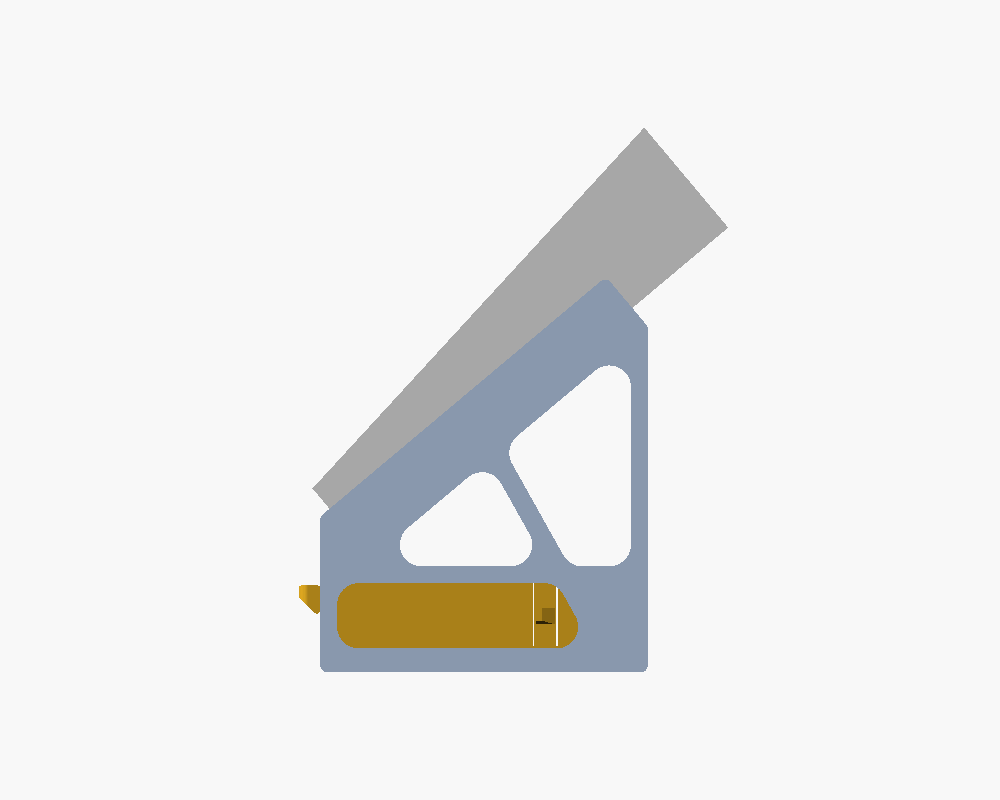
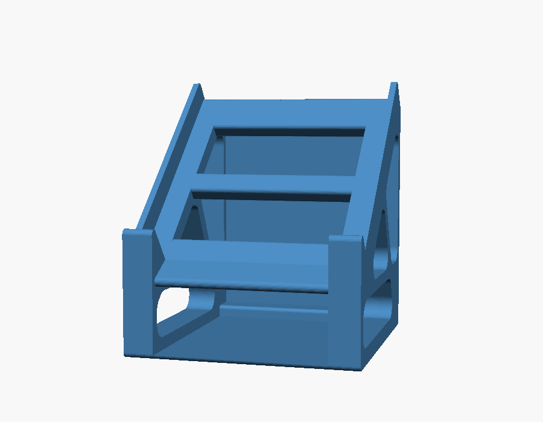
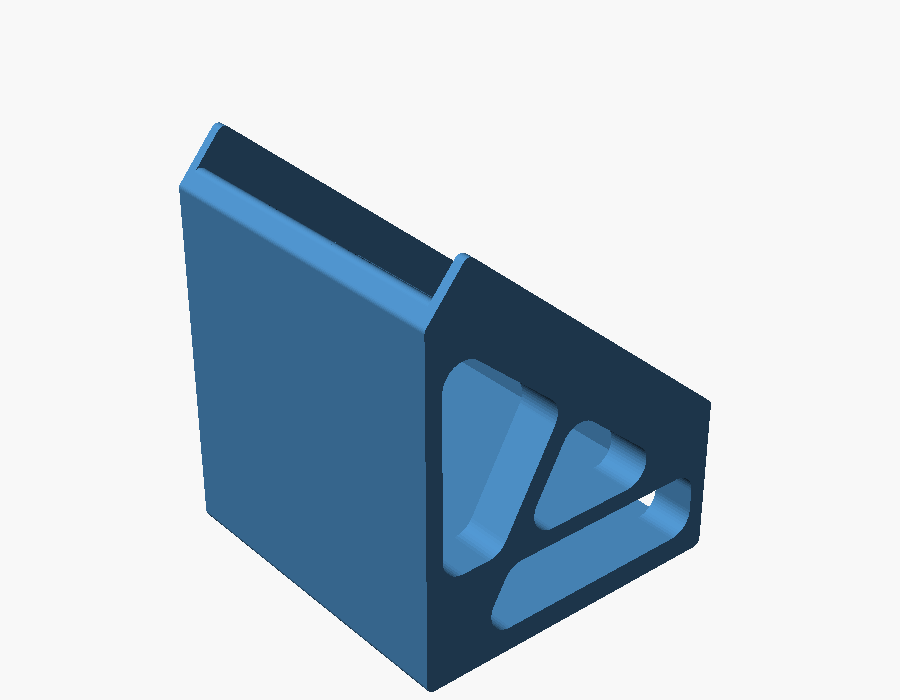
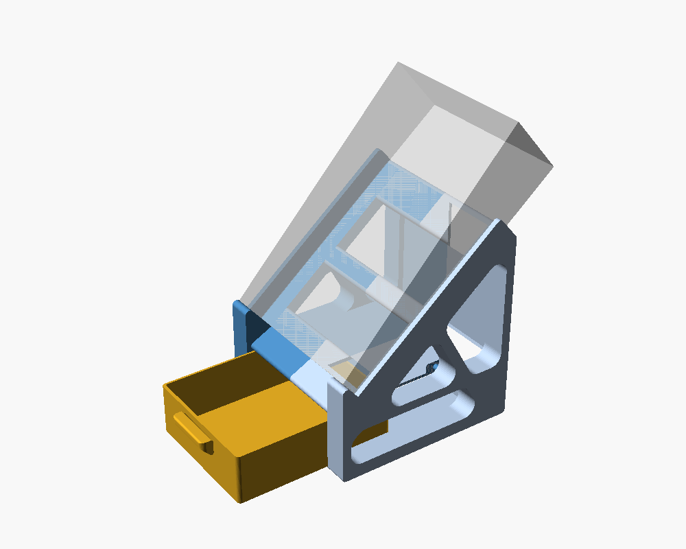
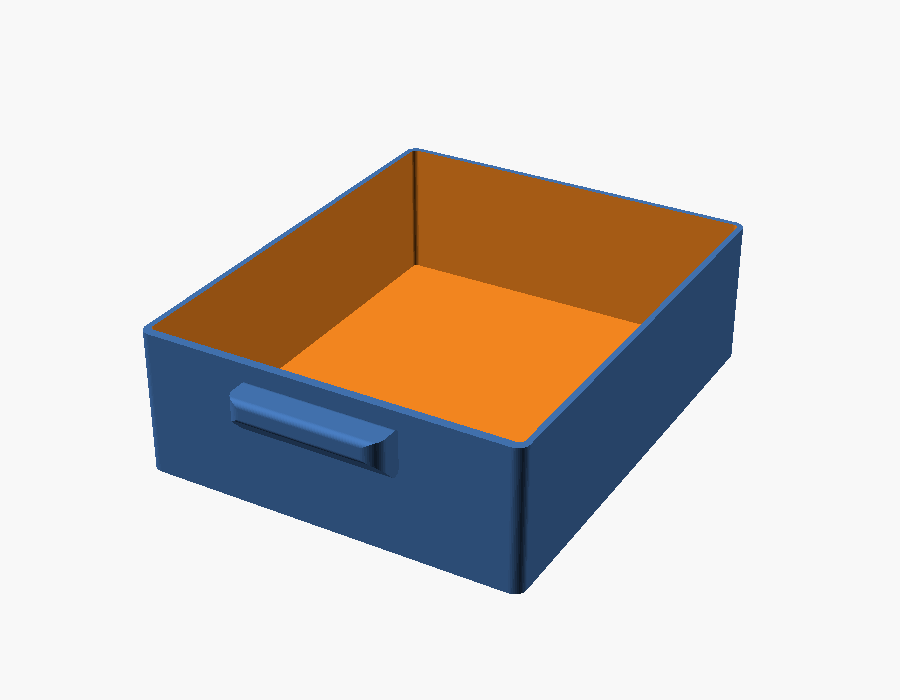
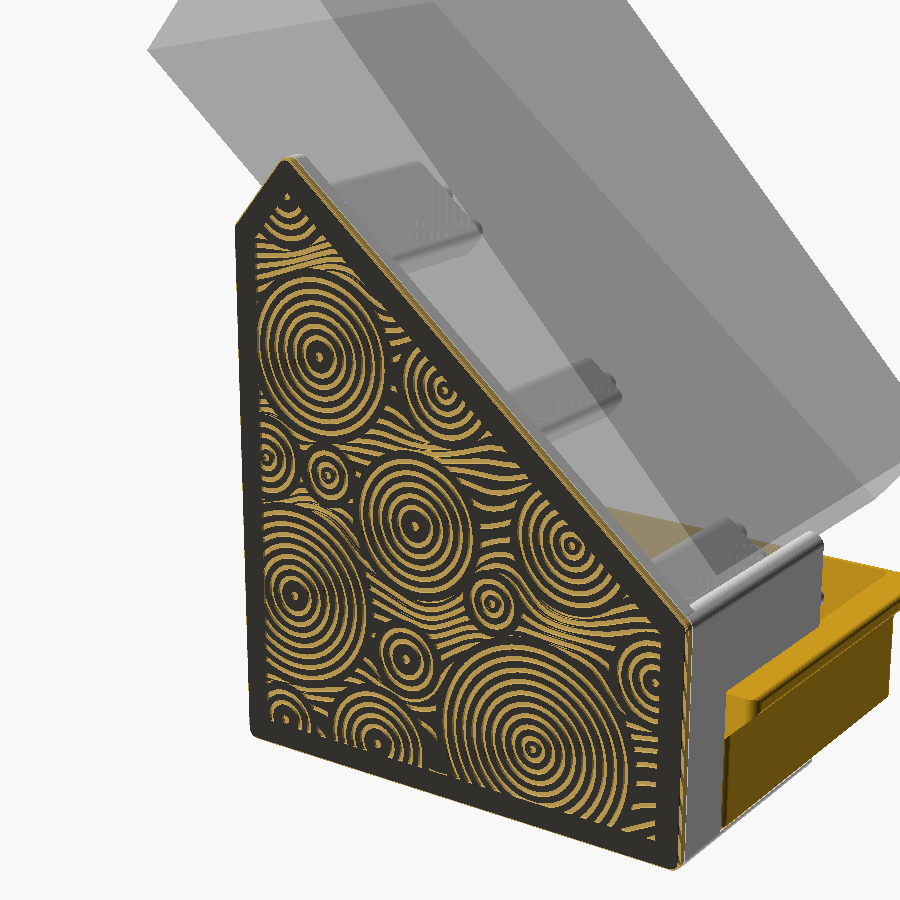

# AG03（初代）用 40° スタンド（ネジ・接着剤なし）

YAMAHA AG03（初代。AG03MK2 にも切替可）を **底面40°** に傾けてデスクに置くための土台です。

- **ネジ・接着剤ゼロ**：左右2パーツを圧入ダボ（直径6mm × 8か所）で差し込むだけ。床板の継ぎ目は相欠き（重ね継ぎ）で上下にずれない
- **引き出し付き**：AG03 の下の空間に、手前に引き出せるトレイ（内寸 約112 × 98 × 35 mm）。左右のフレームの内面がガイドになり、台の床板の上を滑るのでレールも不要
  - 閉めると前板が左右の前脚の前面と面一。取っ手は前板の上端を全幅で手前へ張り出した「ひさし」（出っ張り8 mm、上面は引き出しの縁と面一、下面45°でサポート不要）で、指を下から掛けて引く
  - 引き出しの上は台の天井板（厚さ3mm）でふさいであるので、閉めると上からは中が見えない
  - **抜け止め（外から見えない）**：引き出しの底の溝に台の床板の小さな山（高さ0.9mm、パーツA側）が入り、溝の途中の「歯」が山に当たって約84mm引き出したところで止まる。強めに引けば歯が山を乗り越えて外せる
  - 底の外周を0.4mm面取りしてあり、1層目の広がり（象の足）でフレームとこすれにくい
- **底面・背面は閉じた面**：机に接する底は全面が床板（3mm）、AG03 の後ろに隠れる背面も背板（3mm）でふさいである。横の肉抜き穴はそのまま
- **サポート不要**：どちらも外側の側板を下にして寝かせるだけで印刷できる（全部が Z 方向への押し出し形状）
- **端子をふさがない**：背面端子は上向きになるので完全フリー（初代 AG03 は前面のストッパーが当たる範囲に端子がない）
- **前倒れ防止**：手前ストッパーの先端から机まで垂直に落とした前脚を左右の角に設置
- **前板**：左右の手前ストッパーを全幅の前板（高さ17mm）でつなぎ、前脚・引き出しの前面と面一の平らな正面にした
- **横ズレ防止**：左右の側板（ガイド壁 高さ17mm）で本体をはさむ。AG03 は全体が曲面仕上げなので、一番幅のある高さ（底から17mm）で前板・側板の両方が受ける
- **シンプルな外形**：平らな底・垂直な前面と背面・傾斜面だけで構成。外に出る角は R3 で丸め、肉抜き穴は角を R9 で丸めた三角形

    

## ファイル

| ファイル | 内容 |
|---|---|
| `ag03_stand.scad` | パラメトリック設計データ（OpenSCAD） |
| `ag03_stand_half_a.stl` | パーツA（ダボ＝オス）。この向きのまま印刷 |
| `ag03_stand_half_b.stl` | パーツB（ダボ穴＝メス）。この向きのまま印刷 |
| `ag03_stand_drawer.stl` | 引き出し。開口を上にしてこの向きのまま印刷 |
| `ag03_stand_fit_test.stl` | 圧入テスト片（直径6mmのダボ＋穴のクリアランス 0.10 / 0.15 / 0.20mm、溝の本数 1/2/3 本が目印） |

## 寸法

| 項目 | 値 |
|---|---|
| 1パーツの印刷サイズ | 約 136 × 163 × 77 mm（Bambu A1 mini 等 180mm 角ベッドに収まる） |
| 引き出しの印刷サイズ | 外寸 117 × 101 × 37 mm＋取っ手 8 mm（内寸 約112 × 98 × 35 mm、前板・底 2.4mm、壁 1.6mm） |
| 組立後の外形 | 幅 約138mm × 奥行 約136mm × 高さ 約163mm |
| 本体手前下端の高さ | 55 mm（この下を引き出しが通る。前面プラグの逃げも兼ねる） |
| 手前ストッパー・側板の高さ | どちらも 17.0 mm（本体底面から）。前板は全幅で AG03 の前面を受ける |
| 本体を乗せた全高 | 約 226 mm |
| 重心 | 本体（坂形）の重心は机の上で前脚の前面から約87mm・台の後端から約49mm（接地の奥行 約136mm の内側）→ 前にも後ろにも倒れにくい |

初代 AG03 で設計（同梱STLはこの寸法）。幅 128.8 mm・手前の高さ 28.0 mm・奥の高さ 54.3 mm は実機のノギス実測値、奥行 202 mm は公称値。初代は天板が底面に対して約7.4°手前に傾いた坂形なので、底面40°に置くと操作面は約47.4°になります。側板の内側は 130.0 mm（片側すき間 0.6 mm）。AG03MK2（126 × 63 × 201 mm）に使う場合は `.scad` の `model = "AG03MK2";` に切り替えて書き出してください。

## 側面の化粧パネル（任意）

台の外側の面（印刷時のプレート面）をおおうパネル。裏のリムを台の側面の肉抜き穴（下段の長穴・上段の三角2つ）に差し込んで摩擦で留める。台は刷り直し不要、ネジ・接着剤なし。



| ファイル | 内容 |
|---|---|
| `ag03_stand_panel_a.stl` | 左パネル（パーツA側）。表面を下にしてこの向きのまま印刷 |
| `ag03_stand_panel_b.stl` | 右パネル（パーツB側）。同上 |
| `ripple_pattern.scad` | 「波紋」模様のデータ（`tools/gen_ripple.py` で自動生成。`--seed` を変えると円の配置が変わる） |

- 厚み 2.4mm。表面に模様を 0.8mm 彫ってある。**0.4mm（2層目のあと）でフィラメントを替える**と、表の色と模様の色の 2 色になる（Bambu Studio：レイヤーを右クリック →「フィラメント交換を追加」）
- 既定の模様は「波紋」（大小の同心円のすき間を、円をよけて流れる波線で埋める）。`panel_style` で `eq` / `wave` / `grille` / `lines` / `relic` / `rune` / `stone` / `plain` にも切り替えられる（比較：`side_panel_concepts.png`、`side_panel_concepts_fantasy.png`）
- リムと穴のすき間は 0.10mm（`plug_tol`）。緩ければ 0.05、固ければ 0.15 に
- 付けると左右に 2.4mm ずつ厚くなる（幅 約143mm）。AG03 の収まる内寸は変わらない

## 印刷設定（目安）

- 素材：PLA または PETG
- レイヤー 0.2mm / 壁 3周 / インフィル 15〜20%（ジャイロイド）/ **サポートなし**
- 1パーツ あたり 約120〜140g（2個で 約260g）、引き出し 約60g
- 床板・背板・天井板は印刷の向きだと高さ約51mmの薄い壁になるので、**ブリム（5mm程度）を付ける**と揺れ・反りを防げる。壁の周回数は 4 周以上にすると板が中まで詰まる
- ダボと床板の舌（パーツAの上に飛び出す細い部分）は最後に印刷される小さな部分なので、スライサーの「最小レイヤー時間」を有効にして冷却を確保するときれいに出る
- 引き出しは象の足補正（Elephant foot compensation）0.1〜0.2mm も併用するとよりスムーズ
- 引き出しは壁が薄い（1.6mm）ので、壁の周回数は 4 周（0.4mmノズル）にすると中まで詰まって丈夫

## 組み立て

1. まず `fit_test` を印刷して、手で押し込んで「固いけど入る」穴を確認（溝の本数＝ 1本:0.10 / 2本:0.15 / 3本:0.20mm）
2. 0.10mm（1本溝）以外がちょうど良ければ `fit_tol` を書き換えて STL を再出力（同梱STLは直径5mmダボのテストで ① 0.10mm がぴったりだった結果を反映。直径6mmでも同じ値の見込みだが、テスト片で確認推奨）
3. パーツA のダボと床板の舌をパーツB の穴・切り欠きに合わせ、机の上で手のひらで押し込む
4. AG03 を乗せ、手前の角を左右のストッパーに当てる
5. 引き出しを手前から差し込む（途中で歯が床板の山をコクッと乗り越える。奥は後ろ下の横桁に当たって止まる）

## 調整できる主なパラメータ（`ag03_stand.scad` 冒頭）

| 変数 | 既定値 | 意味 |
|---|---|---|
| `tilt` | 40 | 傾き角 [°] |
| `H0` | 55 | 本体手前下端の高さ。下げると引き出しが浅くなる（引き出しの高さは自動で追従） |
| `drawer_open` | 0 | プレビューで引き出しを引き出す量（形状には影響しない） |
| `S` | 150 | 傾斜面で支える長さ |
| `clr` | 0.6 | 本体と側板の片側すき間（実機の幅を測って調整） |
| `lip_h` / `guide_h` | 17.0 / 17 | 手前ストッパー（前板）・側板の高さ |
| `frame_w` | 14 | 側面フレーム（＝手前ストッパー）の横幅 |
| `R_hole` / `R_out` | 9 / 3 | 肉抜き穴・外形の角R |
| `peg_d` | 6 | ダボの直径 |
| `det_u` / `det_bh` | 97 / 0.9 | 抜け止めの歯の位置（引き出しの前面から）／床板の山の高さ。歯の位置を大きくすると深く引き出せ、山を高くすると止まる力が強くなる（上のすき間0.8mmに対して1.0mm以下推奨） |
| `fit_tol` | 0.10 | ダボ穴のクリアランス（テスト片で決定） |

STL の書き出し：

```bash
openscad -D 'part="half_a"' -o ag03_stand_half_a.stl ag03_stand.scad
```

```bash
openscad -D 'part="half_b"' -o ag03_stand_half_b.stl ag03_stand.scad
```

## 注意

- 角度は **本体の底面** が水平から40°という定義です。
- AG03 は全体が曲面仕上げのため、一番幅のある高さ（底から17mm）に合わせて前板・側板の高さを決めています。
- 本体は側面が坂形の単純な立体（角の丸みなし）としてモデル化しています。
- 机の上で滑る場合は、底面にシリコンのすべり止めシートを敷く（接着不要）のがおすすめです。
